  
  
  
  

### 🧭 About me

I build data pipelines on **Azure** and **Databricks**, and web apps with **React**, **Django**, and **Flask**. I'm at the **World Bank Group** and studying for an MS in Data Science at **UMass Dartmouth**.

<b>🛠️ Tech stack</b> (click to expand)

 

| Area | Tools |
|---|---|
| Data & cloud | Azure · Databricks · PostgreSQL · MySQL · Airflow |
| Backend | Python · Django · Flask |
| Frontend | React · Next.js · D3.js |
| Tooling | Docker · Git · Linux · VS Code |

<picture>
  <source media="(prefers-color-scheme: dark)" srcset="https://skillicons.dev/icons?i=python%2Cazure%2Cpostgres%2Cmysql%2Creact%2Cnextjs%2Cdjango%2Cflask%2Cdocker%2Cgit%2Clinux%2Cvscode&theme=dark" />
  
</picture>

### 🚀 Featured projects

  
  
  
  
  
  

<b>📂 More projects</b>

 

- [**DocViz source**](https://github.com/PraveenGanapathy/DocViz)
- [**appletv_d3js**](https://github.com/PraveenGanapathy/appletv_d3js): visualization using D3.js
- [**playlistimporter**](https://github.com/PraveenGanapathy/playlistimporter): imports YouTube playlists to other platforms
- [**portfolio**](https://github.com/PraveenGanapathy/portfolio): my personal site
- [**online-resume**](https://github.com/PraveenGanapathy/online-resume)

### 📊 GitHub activity

  
  

<i>"Data is the new oil, but the engine is the Engineer."</i>

